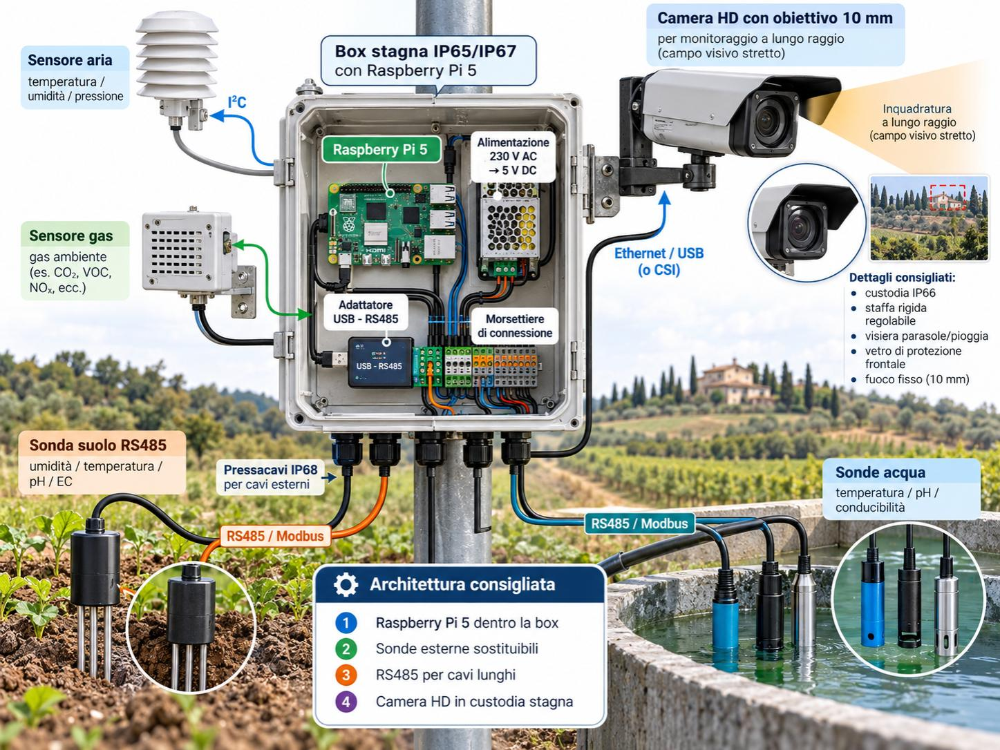

# Smart camera per il monitoraggio visivo in campo

Questo è il repository della nostra tesi triennale: una smart camera da lasciare in un frutteto (o in un campo) che fotografa gli insetti e registra le condizioni ambientali, cercando di consumare meno energia possibile. Qui raccogliamo codice, firmware, schemi elettrici e appunti di configurazione man mano che il progetto va avanti.

**Tesisti:** David Cardinali e Tommaso Garofani  
**Relatore:** Francesco Betti Sorbelli  
**Correlatori:** Lorenzo Palazzetti e Cristina M. Pinotti  
**Università degli Studi di Perugia**. Raccolta dati in campo prevista per la **primavera 2027**.

Documenti da cui partire:

- [`docs/plan.pdf`](docs/plan.pdf): il piano operativo che fa da riferimento per obiettivi e requisiti;
- [Guida al codice](docs/guida-codice.md): cosa fa ogni file sorgente e cosa ancora non fa;
- [Configurazione e risveglio](docs/setup-risveglio.md): come configurare Pi ed ESP32 e in che ordine fare le prove al banco;

Per la parte di acquisizione selettiva ci basiamo sul manoscritto *A Two-Tier Biology-Aware Wake-Up Control for Energy-Measured IoT Insect Monitoring*. Il manoscritto è riservato e per questo **non è incluso nel repository**.

---

## L'idea in breve

Vogliamo costruire una camera **modulare**: un box stagno con dentro un **Raspberry Pi 5**, un **ESP32**, due fotocamere e una morsettiera a cui collegare i vari sensori. All'inizio sarà alimentata dalla rete elettrica.

I casi di studio possibili sono la cimice asiatica (BMSB), formiche, bombi, api e altri insetti. Un caso a parte è l'**afide lanigero del melo**: i singoli individui sono troppo piccoli per essere contati, quindi lì misuriamo l'**area delle colonie lanose** e come cambiano nel tempo.

Lo stesso hardware deve supportare **due applicazioni**, che cambiano solo nel software:

| Applicazione | A cosa serve | Cosa fa il Raspberry |
|---|---|---|
| **Acquisizione selettiva** (studio energetico, rif. TMC) | Accendere il Pi solo quando ha senso scattare, per risparmiare energia | Resta in halt; l'ESP lo sveglia, il Pi scatta, analizza e torna in halt |
| **Monitoraggio continuativo** | Costruire un dataset di immagini e misure | Resta acceso in una fascia oraria (es. dalla mattina alla sera) |

In entrambi i casi l'analisi delle immagini (rilevamento degli insetti o segmentazione delle colonie) gira direttamente sul Raspberry.



*Bozza di come potrebbe essere l'installazione in campo, proposta dal professore come spunto. È un'idea di partenza e non il progetto definitivo: alcune scelte, come i sensori RS485, sono diverse da quelle del piano.*

---

## Architettura

```
                              campo (outdoor)
 ┌──────────────────────────────────────────────────────────────────┐
 │  Box principale                                                  │
 │  ┌──────────────┐  WAKE (PC817 → pad J2)    ┌──────────────────┐ │
 │  │  ESP32-CAM   │──────────────────────────►│ Raspberry Pi 5   │ │
 │  │ camera di    │◄── ALIVE (GPIO17) ────────│ + 2 fotocamere   │ │
 │  │ rilevamento  │──► UART: misure BME ─────►│ Camera Module 3  │ │
 │  │  (sempre on) │    (solo a Pi acceso)     │ + 2ª ottica      │ │
 │  └──────┬───────┘                           └────────┬─────────┘ │
 │         │ cavo I2C a tenuta                          │           │
 │         ▼                                            ▼           │
 │  ┌──────────────┐                    metano, suolo, acqua, GPS   │
 │  │   BME280     │                    (letti solo a Pi acceso)    │
 │  │  (custodia   │                                                │
 │  │   3D fuori)  │                                                │
 │  └──────────────┘                                                │
 │                                                                  │
 │  salvataggio locale → database (misure, foto, GPS, log, CV)      │
 │  → Wi-Fi / modem 4G → accesso remoto, backup, scambio con drone  │
 └──────────────────────────────────────────────────────────────────┘
```

La scelta più importante è la **divisione dei compiti tra le due schede**:

- l'**ESP32-CAM** consuma poco e resta **sempre acceso**. Con la sua piccola camera di bordo sorveglia la scena e, nell'app selettiva, sveglia il Pi quando vede qualcosa. Legge anche il BME280 (temperatura, umidità, pressione): quando il Pi si accende gli manda la misura del risveglio e poi una al minuto;
- il **Raspberry Pi 5** consuma molto di più. Fa le foto, legge gli altri sensori, analizza le immagini e salva tutto. Nell'app selettiva passa la maggior parte del tempo in halt.

Il BME280 sta **fuori** dal box, in una custodia stampata in 3D e collegato solo all'ESP con un cavo a tenuta. Se lo mettessimo dentro misurerebbe il calore delle schede invece dell'aria esterna.

| Componente | Collegato a | Note |
|---|---|---|
| BME280 (T, UR, pressione) | solo ESP32 | custodia 3D esterna |
| Metano, umidità del suolo, sensore acqua, GPS | solo Raspberry Pi | si leggono solo a Pi acceso |
| Due fotocamere | Raspberry Pi | supporti fissi, orientate a mano in installazione |
| Camera di rilevamento (OV2640 o simile) | ESP32-CAM, con cavo flat | solo per decidere quando svegliare il Pi |

### Come si sveglia il Pi

Il Pi 5 non ha una vera sospensione in RAM, quindi per noi esistono due stati: **acceso** e **halt** (spento via software, ma ancora collegato all'alimentazione). Con l'opzione EEPROM `POWER_OFF_ON_HALT=1`, in halt il consumo scende a circa 0,01 W.

Per riaccenderlo usiamo i **pad J2** della scheda, che sono gli stessi contatti del pulsante di accensione. Le due schede si parlano con due fili:

| Linea | Direzione | A cosa serve |
|---|---|---|
| WAKE | GPIO12 ESP → optoisolatore PC817 → pad J2 | "preme" il pulsante di accensione con un impulso di 200 ms |
| ALIVE | GPIO17 Pi → GPIO2 ESP | dice all'ESP se il Pi è acceso |
| UART | GPIO14 ESP → GPIO15 (RXD) Pi | misure del BME280 dall'ESP al Pi (solo a Pi acceso) |

Lo schema del circuito è in [`hardware/pi5->esp32/`](hardware/pi5-%3Eesp32/circuito.png). Tutti i dettagli sono in [configurazione e risveglio](docs/setup-risveglio.md).

Il ciclo dell'app selettiva, quando sarà completo, funzionerà così:

```
la camera dell'ESP vede un evento (in futuro: anche forecaster + decider)
  → impulso WAKE sui pad J2
  → il Pi si avvia
  → systemd lancia raspberry_pi/capture_rpi.sh --oneshot
  → foto JPG + lettura dei sensori del Pi
  → systemctl poweroff → di nuovo in halt
```

---

## Hardware

**Raspberry Pi 5** (hostname e utente `rpi5-03`): Raspberry Pi OS 64-bit (Bookworm) su microSD da 32 GB. Accesso via SSH, rete Wi-Fi o Ethernet; in campo useremo un modem 4G esterno.

**Fotocamere:**

| Fotocamera | Stato | Note |
|---|---|---|
| Camera Module 3 (IMX708) | funzionante | `rpicam-still`, JPG fino a 4608×2592 |
| Seconda camera | da scegliere | candidata: [High Quality Camera](https://www.raspberrypi.com/products/raspberry-pi-high-quality-camera/) con obiettivo a lunga focale; nel frutteto lavoriamo fino a ~4 m |

La seconda ottica va scelta **prima** di progettare il box, perché da lei dipendono ingombri, finestra trasparente e fissaggi.

**ESP32:** ESP32-CAM con pinout AI-Thinker, con la camera collegata al connettore a flat della scheda. La scheda non viene modificata: i suoi pin laterali vanno a una board di collegamento con il Pi. La camera dell'ESP serve solo a capire *quando* svegliare il Pi: le foto per il dataset le fanno le fotocamere del Pi. Pin e collegamenti sono in [configurazione e risveglio](docs/setup-risveglio.md#2-esp32-cam-camera-bme280-e-collegamento-con-il-pi).

**Sensori sul Pi:**

| Sensore | Cosa misura | Stato |
|---|---|---|
| Umidità del suolo | umidità del terreno | modello e interfaccia da scegliere |
| Sensore acqua | da definire nel gruppo | da collegare |
| Metano (serie MQ) | CH₄ | da collegare, via ADC |
| GPS | posizione | da collegare, via UART |

Nel box ci sarà una **morsettiera modulare** con connettori a tenuta e polarizzati, per poter aggiungere o sostituire un sensore senza rifare tutto il cablaggio.

---

## Software

### Acquisizione selettiva

L'idea viene dal manoscritto TMC:

1. l'ESP legge il BME280 e tiene lo storico delle misure (oggi il firmware legge il BME280 ma non tiene uno storico);
2. un **forecaster** (reti GRU quantizzate, abbastanza leggere da girare sull'ESP) prevede temperatura e umidità;
3. un **decider** combina regole biologiche (ad esempio i gradi-giorno) con un classificatore (HistGBT nel paper) e decide se svegliare il Pi;
4. se la risposta è sì, il Pi si accende, scatta, analizza, salva e torna in halt;
5. misuriamo i consumi reali di ogni fase (avvio, caricamento del modello, inferenza, spegnimento).

Nel firmware attuale il risveglio parte da un evento visto dalla **camera dell'ESP** (l'algoritmo di rilevamento è ancora da scrivere); forecaster e decider si aggiungeranno a questo percorso.

Alcune note: nel lavoro TMC la pressione viene registrata ma non entra nel decider, e le regole biologiche sono pensate per la cimice asiatica, quindi per altri insetti vanno validate. Mentre il Pi è in halt i suoi sensori non vengono letti.

### Monitoraggio continuativo

Il Pi resta acceso nella fascia oraria impostata e raccoglie misure e foto con cadenze indipendenti (il piano propone una misura al minuto e una foto ogni cinque minuti). Serve un **database** che tenga insieme misure, immagini, GPS, log e risultati dell'analisi. Gli orologi di ESP e Pi vanno sincronizzati, e per ogni misura bisogna distinguere l'orario in cui è stata *fatta* da quello in cui il Pi l'ha *ricevuta*.

### Connettività

All'inizio useremo il Wi-Fi del laboratorio, poi un modem 4G. Acquisizione e salvataggio devono funzionare anche senza rete; quando la connessione torna, i dati vanno trasferiti senza duplicati e senza cancellare troppo presto gli originali. È previsto anche uno scambio dati wireless con un secondo Raspberry Pi 5 montato su un drone.

---

## Cosa c'è nel repository

| Percorso                        | Contenuto                                                                          |
| ------------------------------- | ---------------------------------------------------------------------------------- |
| `docs/`                         | piano operativo, guida al codice, guida di configurazione, immagini                |
| `raspberry_pi/smartcam/`        | package Python: scatto, lettura sensori del Pi, GPS, metadati delle foto |
| `raspberry_pi/capture_rpi.sh`   | script di avvio dello scatto (a mano o da systemd)                                 |
| `raspberry_pi/systemd/`         | unità systemd e modello delle variabili d'ambiente                                 |
| `raspberry_pi/data/`            | `sensors.csv`, il file in cui finiranno le misure                                  |
| `raspberry_pi/requirements.txt` | dipendenze Python                                                                  |
| `firmware/esp32/`               | firmware PlatformIO per l'ESP32-CAM (camera, wake, BME280, UART)                 |
| `hardware/`                     | schemi KiCad: collegamento Pi–ESP e sensore BME280                                 |

Il codice è ancora a livello di **prototipo**. Il firmware ESP acquisisce i frame della camera, legge il BME280, manda le misure al Pi via UART e sa svegliare il Pi, ma non ha ancora l'algoritmo di rilevamento, forecaster e decider. Sul Pi ci sono i primi script di scatto e lettura sensori, ma pin e sensori non sono ancora la configurazione di campo. I problemi noti sono in [issues.md](issues.md).

Per provare il software del Pi:

```bash
python3 -m venv --system-site-packages .venv
.venv/bin/pip install -r raspberry_pi/requirements.txt
PYENV_ROOT=$PWD/.venv bash raspberry_pi/capture_rpi.sh --oneshot   # una foto + una riga di sensori
```

---

## A che punto siamo

**Fatto:**

- [x] Piano operativo condiviso (`docs/plan.pdf`)
- [x] Raspberry Pi 5 configurato (OS, hostname `rpi5-03`, SSH, rete)
- [x] Camera Module 3 provata con `rpicam-still`
- [x] Strategia halt + WAKE/ALIVE definita
- [x] Schema del circuito di risveglio con optoisolatore PC817
- [x] Schema di collegamento del BME280 all'ESP32
- [x] Prima versione del firmware di risveglio e degli script di scatto e sensori

**Da fare:**

- [x] Corretti i problemi bloccanti del flusso di scatto ([issues.md](issues.md))
- [x] Firmware compilato con PlatformIO (board `esp32cam`)
- [ ] Provare il firmware sulla scheda e tutto il flusso sul Pi vero
- [ ] Correggere i problemi importanti rimasti in [issues.md](issues.md)
- [ ] Scegliere seconda fotocamera e ottica, prove al banco (pixel sul bersaglio)
- [x] Assegnati i pin della ESP32-CAM senza modificare la scheda (WAKE, ALIVE, UART, BME280)
- [ ] Board di collegamento ESP–Pi (PC817, resistenze, connettori)
- [ ] BME280 nella custodia esterna; aggiornare gli schemi KiCad (WAKE su GPIO12, ALIVE su GPIO2, UART su GPIO14, BME280 su GPIO13/15)
- [ ] Montare e provare il circuito di risveglio; verificare che ESP e BME restino alimentati con il Pi in halt
- [x] Firmware unico: camera, wake manuale, lettura BME280 e invio al Pi (UART)
- [ ] Firmware: rilevamento con la camera dell'ESP (`eventDetected()`)
- [ ] Firmware: forecaster e decider
- [ ] Programma sul Pi che riceve le misure dell'ESP e le salva nel database
- [ ] Collegare i sensori al Pi (modelli, ADC, connettori a tenuta)
- [ ] CAD del box e delle custodie, stampa 3D, prove di tenuta all'acqua
- [ ] Software delle due applicazioni (database, cadenze)
- [ ] Modelli di visione sul Pi, valutati su dati separati da quelli di sviluppo
- [ ] Wi-Fi / 4G, accesso remoto, collegamento con il Pi sul drone
- [ ] Campagna di raccolta in campo (primavera 2027)

---

## Glossario

| Termine | Significato |
|---|---|
| **Halt** | Il Pi è spento via software ma ancora alimentato: si riaccende dal pulsante o dai pad J2. |
| **Wake** | L'impulso con cui l'ESP32 accende il Pi. |
| **ALIVE** | Segnale dal GPIO17 del Pi all'ESP. Dice solo che quel pin è alto, non che Linux abbia finito il boot. |
| **Pad J2** | I due contatti sulla scheda del Pi 5 collegati al pulsante di accensione: chiuderli brevemente accende il Pi. |
| **PC817** | Optoisolatore: un LED e un fototransistor nello stesso chip. Permette all'ESP di "chiudere" J2 senza collegamento elettrico diretto. |
| **EEPROM** | Memoria del Pi 5 con la configurazione del bootloader, tra cui il comportamento in halt. |
| **`POWER_OFF_ON_HALT=1`** | Opzione EEPROM che in halt spegne anche il 3,3 V: consumo ~0,01 W. |
| **Forecaster** | Il modulo sull'ESP che prevede temperatura e umidità. |
| **Decider** | Il modulo sull'ESP che decide se svegliare il Pi. |
| **GRU quantizzate** | Reti neurali ricorrenti alleggerite (pesi a pochi bit) per girare su un microcontrollore. |
| **HistGBT** | Histogram-based Gradient Boosting Trees: il classificatore usato dal decider nel paper. |
| **Gradi-giorno** | Somma delle temperature sopra una soglia nel tempo; si usa per stimare lo sviluppo di un insetto. |
| **TMC** | IEEE Transactions on Mobile Computing, la rivista a cui è stato sottoposto il manoscritto di riferimento. |
| **BMSB** | Brown Marmorated Stink Bug, la cimice asiatica (*Halyomorpha halys*). |
| **CV** | Computer vision. |
| **I2C / UART / SPI** | Protocolli di comunicazione: I2C per il BME280, UART per il GPS, SPI per l'ADC. |
| **ADC / MCP3008** | Convertitore analogico-digitale: il Pi non ha ingressi analogici, quindi serve per leggere suolo e metano. |
| **NMEA / `$GPGGA`** | Il formato testuale con cui i GPS mandano la posizione. |
| **Back-powering** | Quando una scheda spenta viene alimentata "di traverso" attraverso i pin di segnale di un'altra. |
| **Strapping pin** | Pin dell'ESP32 che all'avvio decidono la modalità di boot: meglio non usarli come ingressi qualsiasi. |
| **systemd / oneshot** | systemd gestisce i servizi su Linux; un servizio `oneshot` fa una cosa e termina. |
| **Sidecar JSON** | File `.json` con lo stesso nome della foto, in cui salviamo i metadati. |
| **Burst** | Lettura in sequenza di tutti i sensori abilitati, salvata come una riga del CSV. |
