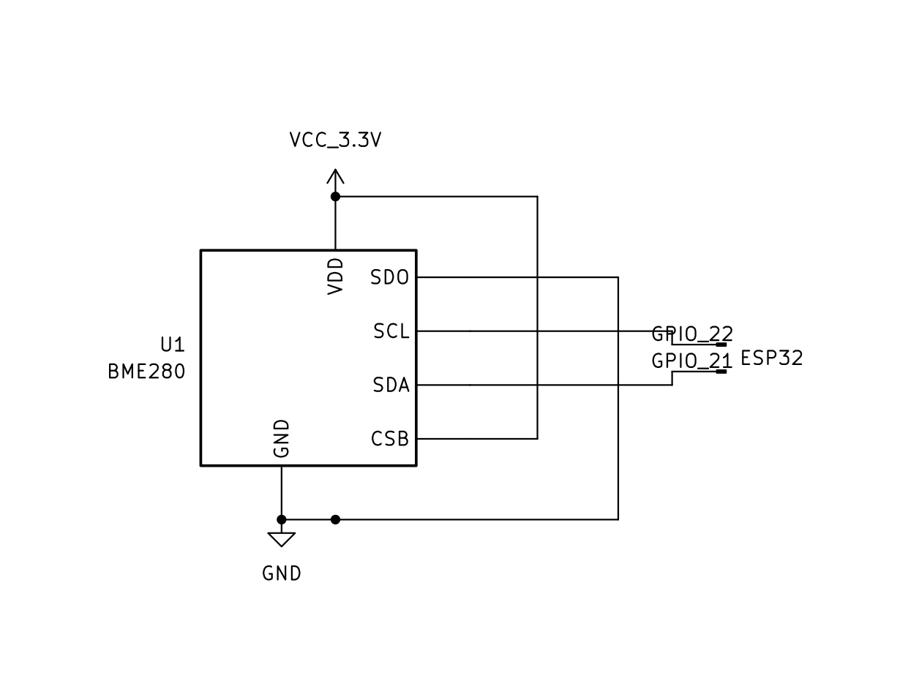

# CIRCUITO ELETTRICO PER IL SENSORE BME280

Si utilizza una scheda di sviluppo `GY-BME280` (che integra il sensore `BME280`) per l'acquisizione dei dati di **temperatura**, **pressione atmosferica** e **umidità**.

## PINset

- **VCC:** Ingresso alimentazione a 3.3 V
- **GND:** Collegamento al meno dell'alimentazione
- **SCL:** (Serial CLock) Pin di recezione del segnale di clock (generato da `ESP32`) per la sincronizzazione della trasmissione tra sensore e micro-controllore. Va collegato al pin **SCL** di ` ESP32 ` (corrisponde a `GPIO 22 `)
- **SDA:** (Serial Data) Linea bidirezionale su cui viaggiano effettivamente i dati (sia i comandi inviati da `ESP32` sia le letture di temperatura, umidità e pressione restituite da `BME280`). Va collegato al pin **SDA** di `ESP32` (corrisponde a  `GPIO 21`)
- **CSB:** (chip select) Serve a selezionare il protocollo o a abilitare il chip. Per attivare la modalità $I^2C$ va lasciato scollegato oppure va collegato a `VCC` (è indifferente in quanto nella scheda è già presente una "resistenza di pull-up" che lo tiene a livello alto selezionando la modalità $I^2C$)
- **SDO:** (Serial Data Out / Address Select) Nella comunicazione $I^2C$, questo pin serve a determinare l'indirizzo esadecimale del sensore sul bus (se lasciato a $0 V$ l'indirizzo $I^2 C$ selezionato è `0x76`; se collegato a $3.3 V$ l'indirizzo $I^2 C$ selezionato è `0x77`. Utile se si devono collegare 2 sensori `BME280` identici sullo stesso `ESP32`.

  

## Tabella riassuntiva dei Collegamenti

| Modulo GY-BME280 | Pin ESP32   | Descrizione                     |
| :--------------- | :---------- | :------------------------------ |
| **VCC**          | **3.3V**    | Alimentazione                   |
| **GND**          | **GND**     | Massa comune                    |
| **SCL**          | **GPIO 22** | Clock I²C                       |
| **SDA**          | **GPIO 21** | Dati I²C                        |
| **CSB**          | **3.3V**    | Selezione modalità I²C          |
| **SDO**          | **GND**     | Imposta indirizzo I²C su `0x76` |
