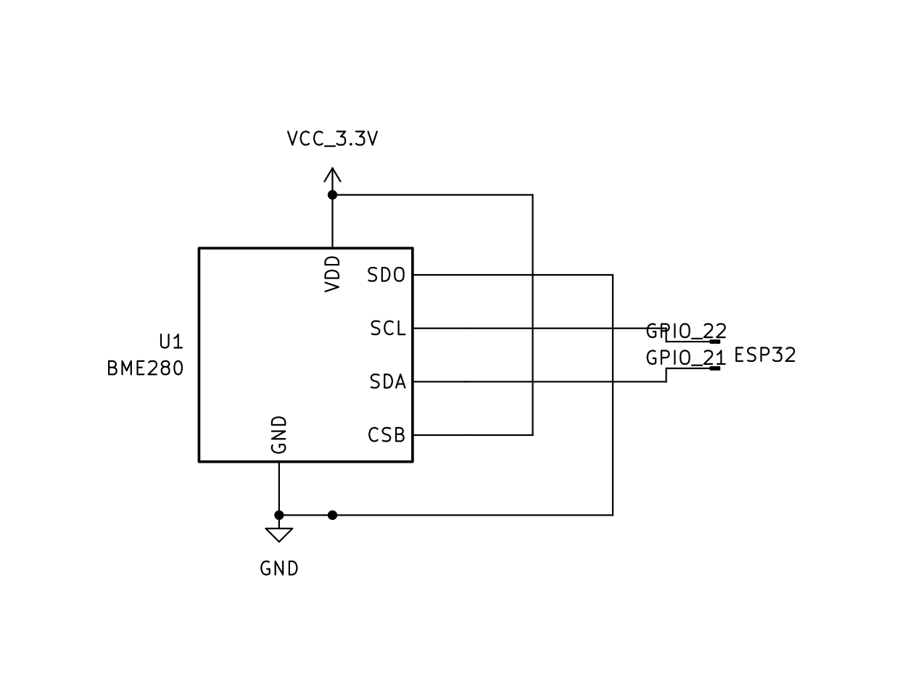

# Collegamento del BME280 all'ESP32-S3-CAM

Per temperatura, umidità e pressione usiamo il modulo GY-BME280, collegato via I2C solo all'ESP32. La mappa completa dei pin è in [`docs/pinout.md`](../../../docs/pinout.md); qui riportiamo solo la parte del sensore.

| GY-BME280 | ESP32-S3-CAM | Funzione |
|---|---:|---|
| VCC | 3V3 | alimentazione a 3,3 V |
| GND | GND | massa |
| SCL | GPIO21 | clock I2C |
| SDA | GPIO47 | dati I2C |
| CSB | 3V3 | alto = modalità I2C |
| SDO | GND | indirizzo `0x76` (a 3V3 diventa `0x77`) |

Il firmware (`firmware/esp32/main/main.ino`, sezione 3) prova da solo `0x76` e `0x77` e legge il chip ID: `0x60` è un BME280, `0x58` un BMP280, che non misura l'umidità. Molti moduli venduti come GY-BME280 sono in realtà BMP280, quindi conviene controllarlo appena il sensore risponde.

Lo schema KiCad e l'immagine qui sotto hanno ancora i pin di una vecchia scheda (GPIO21/22) e vanno aggiornati.

  

## Prove

Il 27/11/2026 la scansione I2C non trovava nessun dispositivo. Le prove da fare con il firmware in modalità diagnostica sono in [`docs/setup-risveglio.md`](../../../docs/setup-risveglio.md#24-il-bme280-non-viene-trovato).

Il cavo verso la custodia esterna può essere lungo. Il modulo ha già i pull-up da 10 kΩ; se con il cavo definitivo le letture sono instabili si può abbassare `I2C_FREQUENZA_HZ` in `main.ino` (per esempio a 50 kHz).

Nella cartella c'è anche il [datasheet del modulo](GY-BME280%20Breakout%20Board%203in1%20sensor%20for%20temperature%20humidity%20and%20air%20pressure-GY-BME280.pdf).
