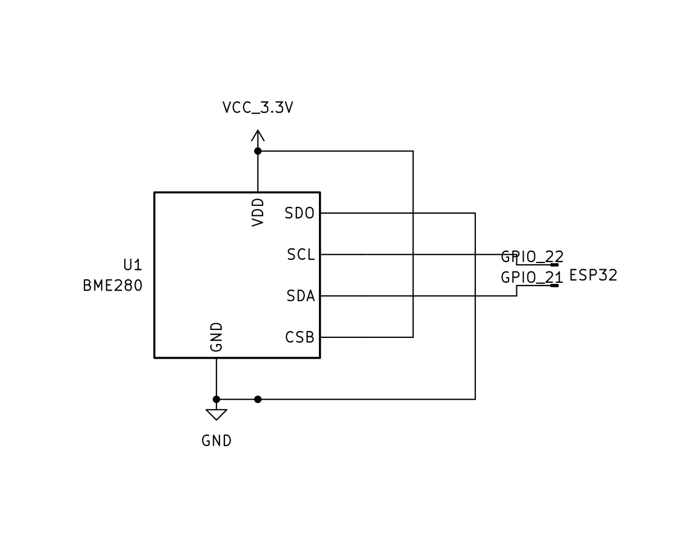

# Collegamento del BME280 all'ESP32-S3-CAM

Per temperatura, umidità e pressione usiamo il modulo **GY-BME280**, collegato all'ESP32 via I2C. La scheda fotografata è una variante ESP32-S3-CAM N16R8 con camera OV3660 e PCB marcato `V1695` / `127294G_Y1127_231016`.

## Pin del modulo e assegnazione firmware attuale

- **VCC**: 3,3 V.
- **GND**: massa comune.
- **SDA**: GPIO47 secondo l'assegnazione attuale in `firmware/esp32/src/main.ino`.
- **SCL**: GPIO48 secondo l'assegnazione attuale in `firmware/esp32/src/main.ino`.
- **CSB**: collegare a 3,3 V per forzare I2C.
- **SDO**: collegare a GND per indirizzo I2C `0x76`; a 3,3 V seleziona `0x77`.

| GY-BME280 | ESP32-S3-CAM | Funzione |
|---|---:|---|
| VCC | 3V3 | Alimentazione |
| GND | GND | Massa |
| SDA | GPIO47 | Dati I2C |
| SCL | GPIO48 | Clock I2C |
| CSB | 3V3 | Seleziona modalità I2C |
| SDO | GND | Indirizzo `0x76` |

  

## Stato e limiti

Questi GPIO sono configurati nel firmware, ma non sono ancora stati verificati con una prova elettrica sulla specifica revisione della scheda. I codici del PCB non hanno permesso di reperire uno schema ufficiale affidabile; verificare serigrafia, continuità e assenza di conflitti prima del cablaggio definitivo. Il pinout GPIO21/22 del vecchio schema KiCad non corrisponde all'assegnazione attuale: lo schema va aggiornato.

Il cavo verso la custodia esterna può essere lungo; collaudare il bus a 100 kHz e ridurre la frequenza I2C se le letture non sono stabili. Il BME280 è letto dalla libreria SparkFun in `firmware/esp32/src/main.ino`.

Nella cartella c'è anche il [datasheet del modulo](GY-BME280%20Breakout%20Board%203in1%20sensor%20for%20temperature%20humidity%20and%20air%20pressure-GY-BME280.pdf).
